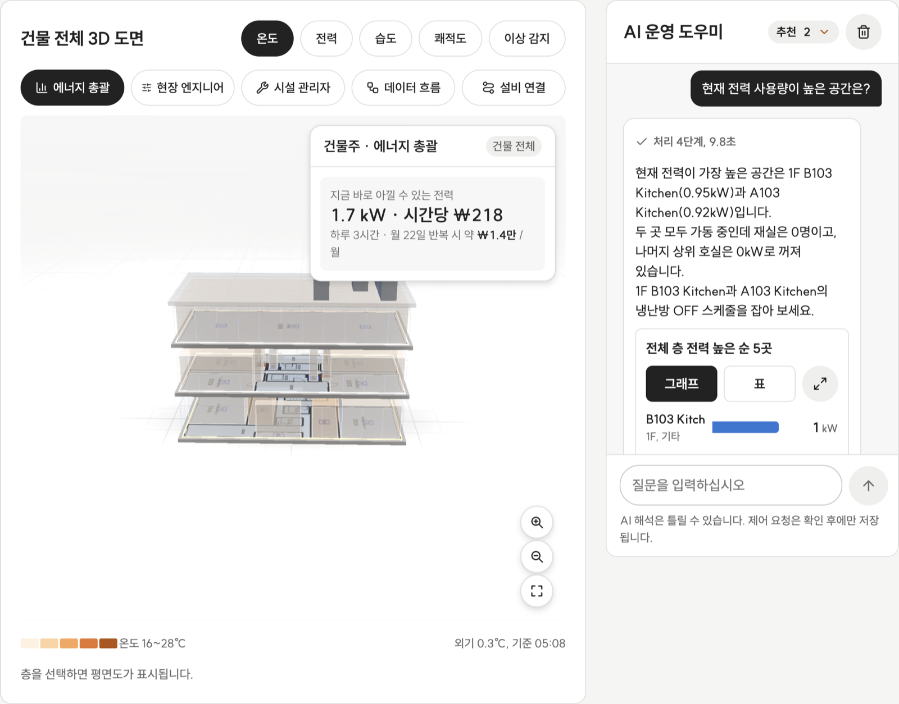
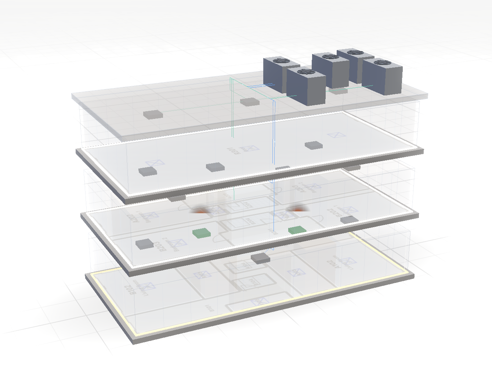
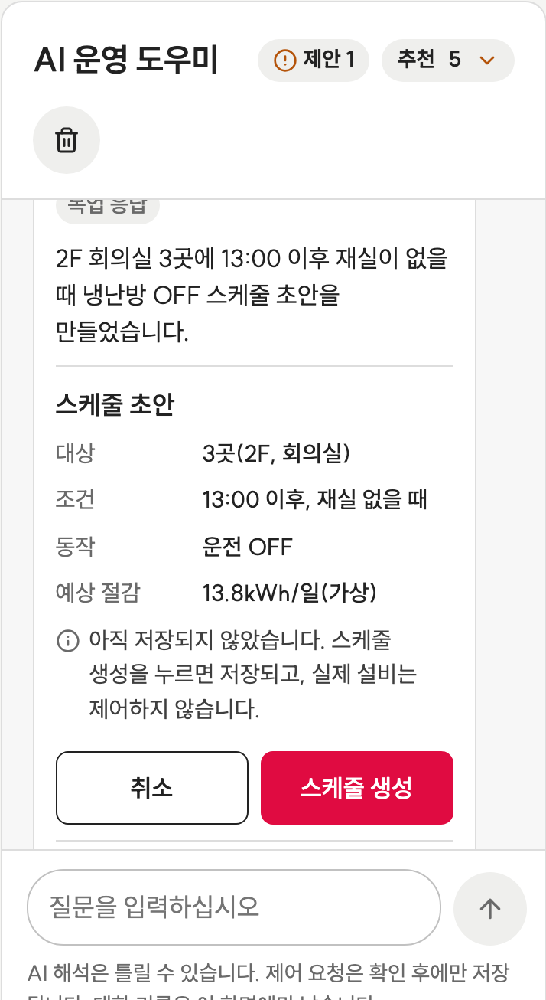
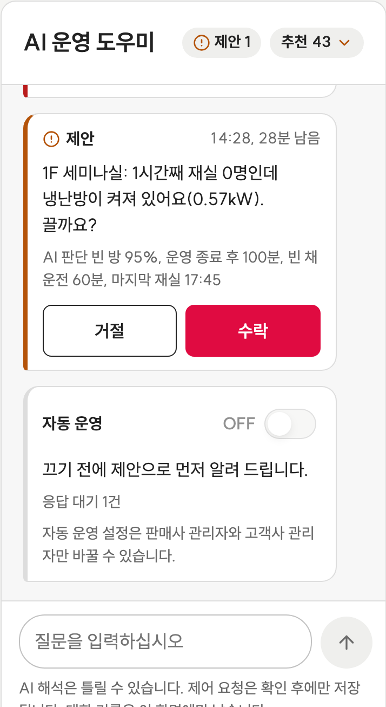
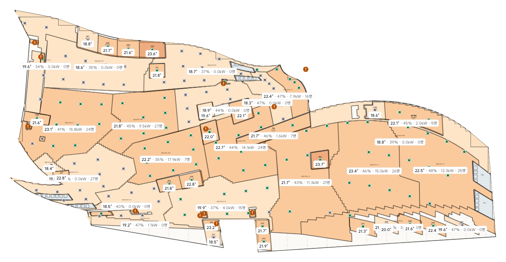
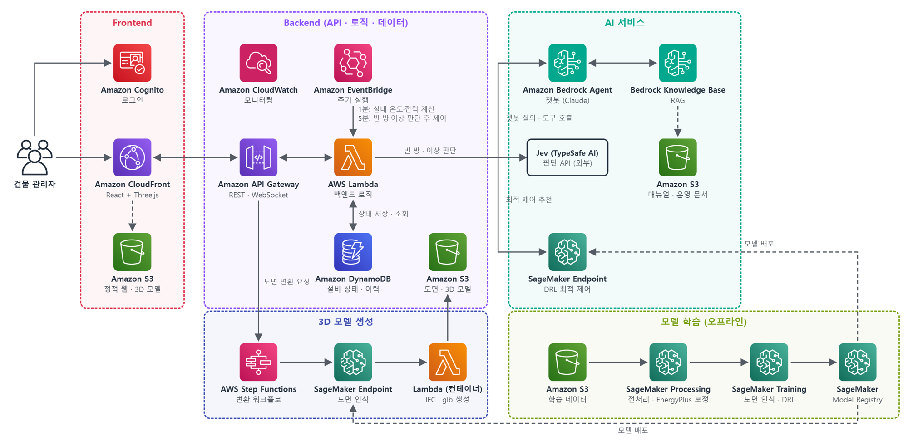

<p align="center">
  
</p>

<h1 align="center">에게(에너지게이트)</h1>

<p align="center">도면 기반 건물 운영 3D 디지털트윈<br>2026 AWS X PNU AI 마에스트로 해커톤, 과제 4(ES 클라우드)<br></p>

> **요약** (기준일 2026-11-22)
>
> - 도면 파일 1개(IFC, CAD, PDF, 이미지)를 3D 디지털트윈으로 변환하고, 운영자가 문장으로 조회하고 냉난방 스케줄을 만드는 B2B 건물 운영 서비스
> - 백엔드, AI, 모델 학습은 모두 AWS 관리형 서비스로 구성. 설정온도, 전력, 재실 수치는 과제 조건에 따른 가상 데이터이며 모든 제어는 시뮬레이터에만 반영
>
> | 지표 | 값 | 비교 기준 |
> |---|---|---|
> | 실제 설계도면 PDF 14쪽 자동 변환 | 2분 47초 | 파싱, 실내기 인식, 병합 전체 |
> | 처음 보는 건물 6동 실내기 인식 재현율 | 0.758(건물 평균) | 7차 모델 0.339 |
> | AI 운영 도우미 평가 | 35/35 정답, 응답 중앙값 4.2초 | 평가 문항 35개 |
> | 빈 방 판단(JEV) 냉방 14일 전력량 | 718.1kWh | 규칙 기반 982.3kWh 대비 -26.9% |

https://github.com/user-attachments/assets/5281b5d5-a623-408f-8f02-a4c8b997aa0b

## 1. 문제 개요

**1-1. 건물 운영자는 도면, 설비 목록, 운전 일정을 따로 확인하고, 빈 공간 운전 같은 낭비를 직접 찾아야 합니다.**

| 근거 | 수치 | 출처 |
|---|---|---|
| 온도를 최대 민원으로 꼽은 시설관리자 | 68% | BOM 2014 업계 설문 |
| BEMS 기능을 잘 활용하는 학교 | 32% | 김성중·이승민 2022, 국내 학교 43곳 |
| 예약 시간 중 실제로 빈 회의실 시간 | 31.2% | Shokrollahi 외 2025, 회의실 7개 |
| 비효율 운전으로 낭비되는 상업 건물 에너지 | 10~30% | PNNL 2008 |

**1-2. 기존 3D 트윈 도구는 BIM 모델(Autodesk Tandem)이나 현장 스캔(Matterport)을 입력으로 요구합니다.**

에게는 과제의 주요 기능 4개(2D에서 3D, 공간-설비 자동 매핑, 실시간 상태 시각화, 사용량 기반 최적 제어)를 다음 3가지 목표로 구현했습니다.

| 목표 | 구현 |
|---|---|
| 도면 형식과 무관한 3D 트윈 생성 | IFC, CAD, PDF, 이미지 4종 입력, 실내기 기호 인식 |
| 조회에서 조치까지 연결 | 문장 1개로 조회, 스케줄 초안, 낭비 추천, 5분 주기 자동 운영 |
| 실측 없이도 근거 있는 수치 | 가상 데이터 표시, EnergyPlus 보정 열모델, 공개 데이터 직접 분석 |

## 2. 핵심 기능

**2-1. 판매사가 도면을 등록하면 3D 트윈이 생성되고, 고객사 운영자는 트윈 위에서 상태를 보고 AI 도우미로 조치합니다.**

| 기능 | 내용 |
|---|---|
| 도면 → 3D 트윈 | IFC, DXF·DWG, PDF, PNG·JPG 입력. 층, 호실, 벽, 문 추출 후 Three.js 3D 생성 |
| 실내기 인식과 모델 매핑 | 실내기 기호 6종 검출, 장비일람표·용량 표기로 LG 국내 모델 45개 대응, 2D 화면 교정 |
| 공간-설비 매핑 | 실내기 위치의 호실 포함 판정, 배치도 없는 호실은 면적 기준 추정 배치, 실외기 계통 연결 |
| 상태 시각화 | 온도, 전력, 습도, 쾌적도, 이상 감지 5개 지표를 호실 색으로 표시, 5초 주기 갱신 |
| AI 운영 도우미 | 문장 조회, 스케줄 초안 생성, 규정 문서 근거 답변(RAG), 되묻기, 다음 조치 제안 |
| 최적 제어 추천과 자동 운영 | 낭비 규칙 3종 추천과 예상 절감량, 5분 주기 빈 방 판단 후 자동 OFF 또는 운영자 제안 |
| 판매사·고객사 구조 | 판매사는 기업 코드 발급과 건물·도면 등록, 고객사는 코드로 가입 후 소속 건물만 관제 |



주: 배포 서버의 실제 응답. "현재 전력 사용량이 높은 공간은?"에 재실 0명인 가동 호실 2곳과 OFF 스케줄을 제안함.

| 건물 설비 연결 | 스케줄 초안 | 자동 운영 제안 |
|---|---|---|
|  |  |  |
| 운전 중 실내기 녹색, 옥상 실외기 계통 | 대상 회의실 3곳, 확인 후 저장 | JEV 판단 빈 방 확률 95% |

## 3. 해결 방법

**3-1. 도면 형식이 건물마다 달라, 형식별 파서를 두고 결과를 공통 형식 `twin.building/v1` 1개로 맞췄습니다.**

| 입력 | 처리 |
|---|---|
| IFC | 공간 형상의 최저 높이 삼각형으로 바닥 다각형 생성. 공개 의원 건물에서 호실 269개, 문 252개 추출 |
| DXF·DWG | 벽 선을 0.5m 팽창해 문 개구부를 막고 빈 영역을 호실로 생성. DWG는 LibreDWG로 DXF 변환 |
| PDF·이미지 | 쪽 렌더링, 벽·방 인식, 실내기 기호 검출 후 병합 |

Step Functions가 파서 컨테이너와 SageMaker 인식 단계를 묶습니다. 신뢰도 0.5 미만 기호는 2D 화면에 확인 필요로 표시하고, 운영자가 교정한 뒤 3D를 만듭니다.

**3-2. 실내기 기호 모양이 설계사무소마다 달라, 합성 데이터와 실제 도면을 섞어 학습하고 건물 단위로 평가를 분리했습니다.**

CubiCasa5K 평면도 5,000장에 기호를 합성하고, 나라장터 공개 설계도면 학습 4동(실내기 169대)을 더해 YOLO11s를 미세조정했습니다. 평가는 학습과 기호 조정에서 제외한 6동(실내기 212대)으로만 수행합니다.

| 버전 | 변경 | 평가 6동 건물 평균 재현율 |
|---|---|---|
| v1 | 단순 선 기호 합성 | 0 |
| v2 | 국내 CAD 기호 합성 | 0.283 |
| v7 | 4방향 카세트 실제 비율 | 0.339 |
| v9(배포) | 실제 도면 4동 학습, 기호 변형 | 0.758, 6동 중 5동 0.8 이상 |

주: 9개 버전 중 4개만 표시함. 모델이 놓친 기호는 운영자가 기호 1개를 지정해 같은 기호를 찾는 기능으로 보완함. 같은 유형의 모델번호는 기호로 구분할 수 없어 원본 모델명, 장비일람표, 용량 표기, 직접 입력 순서로 대응함.

**3-3. LLM 오해석으로 엉뚱한 호실을 제어하지 않도록, LLM은 도구 호출만 만들고 서버가 검증한 뒤 운영자 확인을 거칩니다.**

처리 순서는 문장, 도구 호출(JSON), 서버 검증, 운영자 확인, 시뮬레이터 반영입니다.

- 층, 호실, 동작은 DB 목록에 있는 값만 허용하며, 대상이 0곳이거나 불명확하면 되묻습니다.
- 증감률, 절감량 같은 계산값은 도구가 계산하고 LLM은 그 값을 그대로 씁니다.
- 답변은 구조화 응답(결론, 근거, 조치)으로 받아 3문장 이하로 표시합니다.
- 규정 질문은 Bedrock Knowledge Bases로 고시 원문을 검색하고, 답변 아래에 문서명과 시행일을 표시합니다.

**3-4. 실측 설비가 없어, EnergyPlus로 보정한 5R1C 열 회로망 모델로 가상 수치를 계산합니다.**

EnergyPlus를 요청마다 실행하면 API 제한 시간 29초를 넘기므로, EnergyPlus 결과로 5R1C(ISO 13790) 계수를 보정하고 평소에는 5R1C로 계산합니다.

| 항목 | 값 | 기준 |
|---|---|---|
| 5R1C 계산 시간 | 1.08초 | 호실 533개 × 1개월, Lambda 제한 29초 |
| 보정 오차 CV(RMSE) | 냉방 7.2%, 난방 25.7% | ASHRAE Guideline 14 합격 기준 30% 이하 |
| EnergyPlus what-if 계산 | 6초 안팎 | 5R1C 즉시 값은 수십 ms |

**3-5. 자동 제어를 신뢰할 수 있도록, 후보 선정은 규칙으로 하고 끌지 여부는 판단 모델 JEV의 확률로 결정합니다.**

EventBridge가 5분마다 0·15·30분 전 모두 재실 0명인 운전 호실을 후보로 고릅니다. JEV가 빈 방 확률을 반환하면, 자동 운영이 켜져 있고 확신도 0.8 이상, 빈 방 확률 0.9 이상일 때만 자동으로 끕니다. 그 외에는 운영자에게 제안하고, 자동 조치에는 되돌리기를 제공합니다.

| 방식(EnergyPlus, 부산 기상, VRF 5구역, 냉방 14일) | 전력량 | 규칙 기반 대비 |
|---|---|---|
| 규칙 기반 | 982.3kWh | 기준 |
| JEV 기반 | 718.1kWh | -26.9% |
| DDPG 강화학습(50만 단계) | 1,201.2kWh | +22.3% |

**3-6. 대합실처럼 실내기가 수십 대인 공간은 호실 단위로 관리할 수 없어, 실내기 기준으로 구역을 나눕니다.**

실내기 8대를 넘는 공간만 나누고, 실외기 계통이 다르면 섞지 않으며, 외벽 4.57m 안은 외주부로 분리합니다(ASHRAE 기준). 부산역 대합실은 실내기 128대가 20개 구역이 됐습니다.



## 4. 아키텍처

**4-1. 웹은 CloudFront·S3, API는 API Gateway·Lambda, AI는 Bedrock, 도면 변환은 Step Functions·SageMaker로 처리합니다.**



| 스택 | 구성 |
|---|---|
| `maestro` | 웹 배포, HTTP·WebSocket API, 조회·AI Lambda, Cognito, 도면 변환 Step Functions |
| `maestro-twin` | 건물·호실·설비·상태 DynamoDB 테이블 7개, 1분 상태 계산 |
| `maestro-ops` | 5분 자동 운영, 운영 설정·결정 테이블, JEV 키(Secrets Manager) |
| `maestro-weather` | 30분 기상청 초단기실황 수집 |
| `maestro-sim` | EnergyPlus what-if 계산 컨테이너(Lambda Web Adapter) |

## 5. 사용 기술

| 영역 | 기술 |
|---|---|
| 프런트엔드 | React 19, TypeScript, Vite, Three.js, SVG 차트(차트 라이브러리 미사용) |
| 백엔드 | AWS Lambda(Python 3.12, arm64), API Gateway(HTTP, WebSocket), DynamoDB, S3, CloudFront, AWS SAM |
| 인증·운영 | Cognito, EventBridge, Secrets Manager |
| 도면 변환 | Step Functions, Lambda 컨테이너, ifcopenshell, ezdxf, LibreDWG, pypdfium2, Shapely, OpenCV |
| AI | Amazon Bedrock Claude Sonnet 5.5(도구 호출, 구조화 응답), JEV(TypeSafe AI 판단 API) |
| RAG | Bedrock Knowledge Bases, S3 Vectors, Titan Text Embeddings V2 |
| 모델 학습·추론 | Ultralytics YOLO11s, CubiCasa5K, SageMaker Processing·Training·Model Registry·Serverless Inference, ONNX Runtime |
| 시뮬레이션 | EnergyPlus, 5R1C 열 회로망 모델(ISO 13790), Node.js 컨테이너 Lambda |
| 외부 데이터 | 기상청 초단기실황 API, buildingSMART 공개 IFC, 나라장터 공개 설계도면 |

## 6. 프로젝트 구조

| 저장소 | 내용 |
|---|---|
| [Frontend](https://github.com/Energy-gate/Frontend) | 운영 대시보드(React), 3D 트윈과 도면 → 3D 파이프라인 |
| [Lambda](https://github.com/Energy-gate/Lambda) | API·AI Lambda, 도면 파서 컨테이너, Step Functions 정의, 운영 스택, RAG 문서 |
| [docs](https://github.com/Energy-gate/docs) | 기획, 설계, 기술 선택·개선·장애 기록, 디자인 기준, 모델 학습 코드 |

```text
Frontend/
├── src/            운영, 전력 분석, 시뮬레이션 탭, AI 도우미, 판매사 관리 화면
└── twin/           Three.js 3D 트윈, 도면 → 3D 파이프라인
Lambda/
├── src/            조회, 스케줄, 추천, 이상 감지 API, AI 질의(query, ws), 가상 데이터 시뮬레이터
├── ingest/         도면 파서 컨테이너(IFC, DXF·DWG, PDF → twin.building/v1)
├── statemachine/   도면 변환 Step Functions 정의
├── infra/          twin(1분 상태 계산), ops(5분 자동 운영), weather(기상 수집), sim(EnergyPlus)
├── kb/             RAG 문서(규정, 쾌적 기준)
└── template.yaml   AWS SAM 메인 스택
docs/
├── docs/human/     기획, 설계, 요구사항, 기술 선택·개선·장애 기록
├── ml/             실내기 기호 검출 학습, HVAC 제어 비교(EnergyPlus, JEV, DDPG)
└── DESIGN.md       운영자 화면 디자인 기준
```

상세 설계는 [시스템 설계](https://github.com/Energy-gate/docs/blob/main/docs/human/explanation/architecture.md), 기획 배경은 [서비스 기획](https://github.com/Energy-gate/docs/blob/main/docs/human/explanation/service-plan.md), 결정 경위는 [기술 선택 기록](https://github.com/Energy-gate/docs/blob/main/docs/human/explanation/decisions/README.md)에 있습니다.
